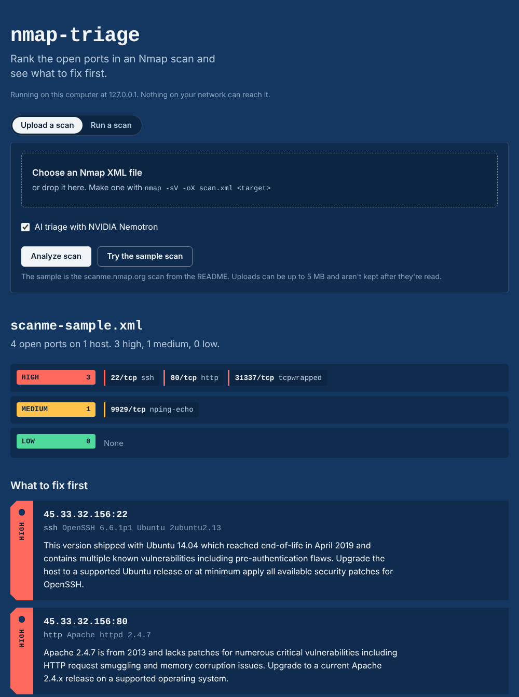

# nmap-triage

Turn raw Nmap XML into a prioritized, human-readable remediation list.

Nmap tells you what's open. It doesn't tell you what to fix first. This CLI parses Nmap XML output, sends the discovered services and versions to an LLM for analysis, and returns each finding ranked **HIGH / MEDIUM / LOW** with a short justification and a suggested remediation step.

Built as a learning project while studying for CompTIA Security+ and working through an M.S. in Technology Management (Cybersecurity Management).

---

## What it does

- Parses standard Nmap XML (`nmap -oX`) — hosts, ports, services, versions
- Sends structured findings to NVIDIA's hosted Nemotron model via the [build.nvidia.com](https://build.nvidia.com) API
- Returns a severity-ranked triage report with reasoning and remediation guidance
- Optionally ships findings to [Axiom](https://axiom.co) for run history and cross-scan querying
- Runs from the command line, or from a local [web app](#web-app) with a color-coded triage board

Model: `nvidia/nemotron-3-ultra-550b-a55b`

## Why

Junior analysts get handed scan output and are expected to know what matters. An open port 22 running a patched OpenSSH is noise; port 445 exposed to the internet is not. This tool is an attempt to encode that first-pass judgment so the analyst starts from a ranked list instead of a wall of XML.

---

## Requirements

- Python 3.9+
- Nmap 7.9+ (to generate the input XML)
- An API key from [build.nvidia.com](https://build.nvidia.com) (free tier available)
- An [Axiom](https://axiom.co) token — optional, only needed for log ingestion

## Setup

```bash
git clone https://github.com/Tilakthapa3/nmap-triage.git
cd nmap-triage
python3 -m venv .venv
source .venv/bin/activate
pip install -r requirements.txt
```

Create a `.env` file in the project root:

```
NVIDIA_API_KEY=your_key_here
AXIOM_TOKEN=your_axiom_token
AXIOM_DATASET=nmap-triage
```

`.env` is gitignored. Never commit your key.

Only `NVIDIA_API_KEY` is required. Omit the Axiom variables and run with `--no-axiom` if you don't need ingestion.

## Usage

Generate a scan:

```bash
nmap -sV -oX scan.xml scanme.nmap.org
```

Run the triage:

```bash
python nmap_triage.py scan.xml
```

### Options

| Flag | Effect |
|------|--------|
| `--output FILE` | Write the report to a file instead of stdout |
| `--no-ai` | Parse and print findings only — no API call, no key needed |
| `--no-axiom` | Skip Axiom ingestion for this run |

`--no-ai` is the fastest way to confirm the parser works against your XML before setting up any credentials.

> Only scan hosts you own or have written permission to test. `scanme.nmap.org` is provided by the Nmap project for exactly this purpose.

---

## Example output

Run against `scanme.nmap.org`:

```
=== Scan Summary ===
Hosts up with open ports: 1
Open ports total:         4

45.33.32.156 (scanme.nmap.org)
  22/tcp  ssh — OpenSSH 6.6.1p1 Ubuntu 2ubuntu2.13
  80/tcp  http — Apache httpd 2.4.7
  9929/tcp  nping-echo — Nping echo
  31337/tcp  tcpwrapped

=== Triage ===

[HIGH] 45.33.32.156:22 — ssh (OpenSSH 6.6.1p1 Ubuntu 2ubuntu2.13)
  This version shipped with Ubuntu 14.04 which reached end-of-life in April 2019 and contains multiple known vulnerabilities including pre-authentication flaws. Upgrade the host to a supported Ubuntu release or at minimum apply all available security patches for OpenSSH.

[HIGH] 45.33.32.156:80 — http (Apache httpd 2.4.7)
  Apache 2.4.7 is from 2013 and lacks patches for numerous critical vulnerabilities including HTTP request smuggling and memory corruption issues. Upgrade to a current Apache 2.4.x release on a supported operating system.

[HIGH] 45.33.32.156:31337 — tcpwrapped (unknown)
  Port 31337 is historically associated with backdoor trojans (e.g., Back Orifice) and the tcpwrapped label suggests access controls hiding the true service. Investigate the listening process immediately with `ss -ltnp` or `lsof -i :31337` and remove if unauthorized.

[MEDIUM] 45.33.32.156:9929 — nping-echo (Nping echo)
  This Nmap testing service reflects traffic and can be abused for amplification or reconnaissance. Disable the service unless explicitly required for authorized network testing.

No other findings.
```

---

## Web app

`app.py` puts a browser front end on the same code. Upload a scan or run one, and every open port lands on a color-coded triage board, with a card for each finding and downloads in Markdown, JSON, or plain text.



### Start it

On a Mac, double-click `start-app.command` in Finder. The first run creates `.venv` and installs the requirements. After that it opens http://127.0.0.1:8765 straight away.

From a terminal:

```bash
source .venv/bin/activate
pip install -r requirements.txt
python app.py
```

Keep the window open while you use it, and press Ctrl+C to stop. Flask's "development server" warning is expected for a tool that only runs on your own machine.

### What you can do

- Upload an `nmap -oX` file, or try the bundled sample scan of scanme.nmap.org
- Run a new scan from the page after confirming you have permission to scan the target (each scan is saved in `scans/`)
- Turn AI triage and Axiom logging on or off for each run
- Jump from any port on the board to its finding, and download the report as Markdown, JSON (one record per port), or the same text the CLI prints

### How it's secured

- Listens on 127.0.0.1 only, so nothing else on your network can reach the scanner
- Scan targets must match a strict hostname/IP pattern and go to Nmap as an argument list with no shell, so input can't add commands or Nmap options. Ranges are capped at /24.
- Every form carries a CSRF token, and requests must use the 127.0.0.1 or localhost host name. That stops other websites from triggering scans through your browser (CSRF and DNS rebinding).
- Uploads are capped at 5 MB, parsed with `defusedxml` (blocks XML bombs and external entities), and not kept after they're read
- Service banners and AI output are treated as untrusted: HTML-escaped on the page and in the Markdown report, under a Content-Security-Policy that allows no inline scripts
- Flask debug mode is never turned on, since its debugger can run code

### Online demo mode

Set `PUBLIC_MODE=1` to serve an upload-only version for a public link. Scanning and Axiom logging are turned off, the page says it's a demo, and AI triage is capped at 20 runs an hour (`AI_HOURLY_LIMIT`) so visitors can't use up your NVIDIA credits.

```bash
pip install gunicorn
PUBLIC_MODE=1 SECRET_KEY=<long random string> ALLOWED_HOSTS=your-domain.com \
  gunicorn -w 1 --threads 4 -b 0.0.0.0:8000 app:app
```

Keep `NVIDIA_API_KEY` in your host's secret settings, never in the code.

---

## Roadmap

- [ ] Map findings to NIST 800-53 / CIS control IDs
- [x] JSON and Markdown export for reporting (web app downloads)
- [ ] Batch mode for multi-host scans

## Notes

This is a portfolio and learning project, not a production security tool. LLM output should be verified before acting on it — treat the ranking as a starting point for analysis, not a substitute for it.

## Author

**Tilak Thapa** — M.S. Technology Management (Cybersecurity Management), Avila University

[tilakthapa.com](https://tilakthapa.com) · [github.com/Tilakthapa3](https://github.com/Tilakthapa3)
